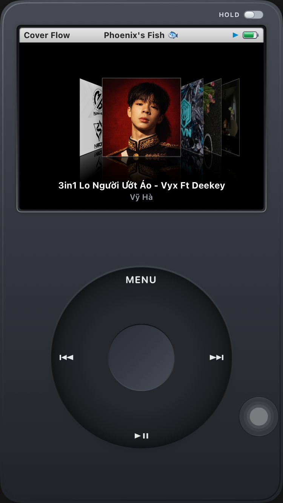
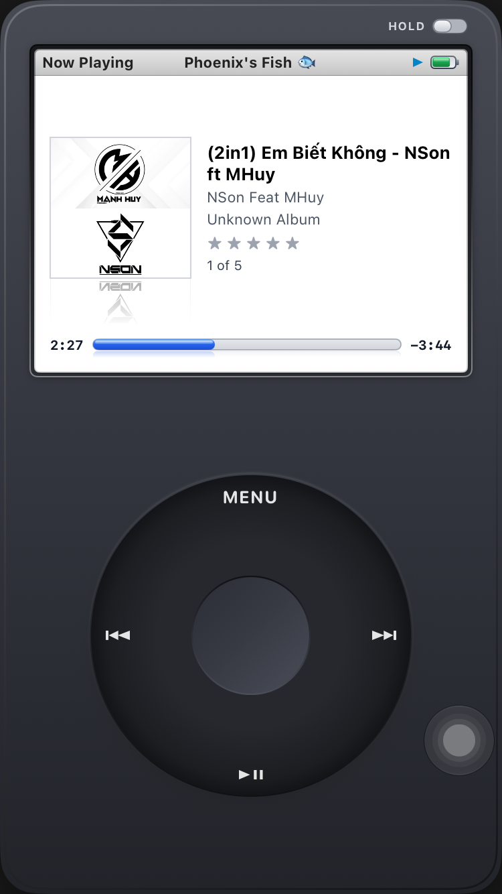
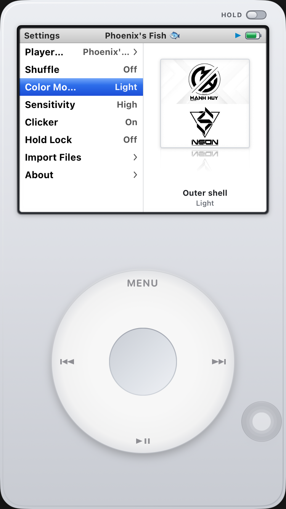
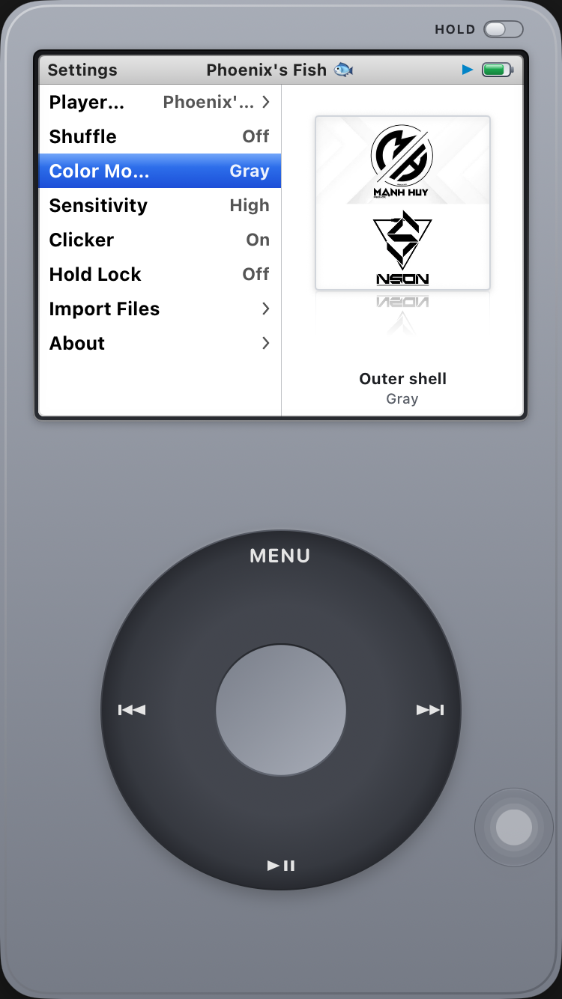
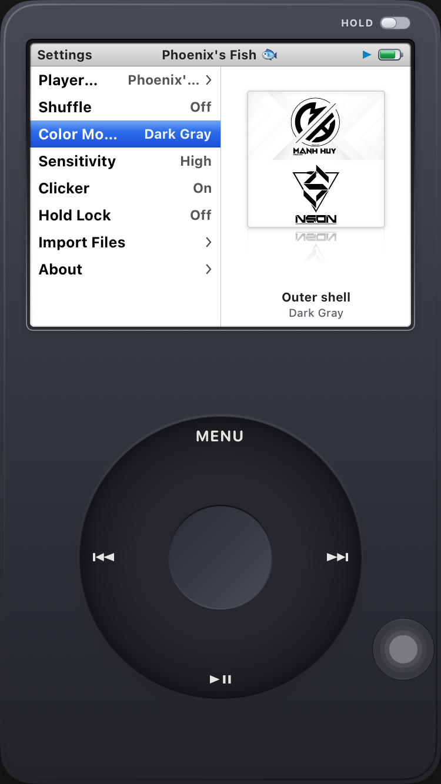

# Retronome 🎧

**Retronome** is an offline retro click-wheel media player for iOS. It faithfully recreates the authentic 6th-generation physical player experience!
Fully vibe-coded by Gemini 4 Argon Medium.

---

## ✨ Features

### 💿 3D Cover Flow
<p align="center">
  
</p>
- **Jewel Case Flip**: Pressing the Center button flips the active album 180° around the Y-axis to reveal the tracklist on the back of the case. Selecting a track starts playback immediately.

### 🎵 Now Playing & Scrubber
- **Playback Group**: Centered 105x105 album artwork with vertical reflection overlay, 5-star rating row, repeat badge (`1` / `∞`), and shuffle indicator.
- **Skeuomorphic Aqua Scrubber**: Recessed track background with high-gloss blue cylindrical capsule fill and specular glass rod highlights.
- **Wheel Scrubbing**: Rotate the Click Wheel clockwise to fast-forward, or counter-clockwise to rewind in 5-second increments.
- **Center Button Cycle**: Pressing Center on Now Playing cycles Repeat mode: **Off** ➔ **Repeat Once** ➔ **Repeat Forever**.
<p align="center">
  
</p>

### 📁 Offline Library & File Importing
- **Zero Network Permissions**: Offline and privacy-respecting by design.
- **Supported Formats**: Audio (`.mp3`, `.m4a`, `.wav`, `.flac`) and Video (`.mp4`, `.mov`).
- **Files App Integration**: Import audio or video files directly from the iOS Files picker.
- **Auto-Hiding Import Actions**: Import buttons stay visible when libraries are empty and gracefully tuck away once files are loaded.
- **Live File Monitoring**: `DispatchSourceFileSystemObject` detects file additions or deletions in the app's `Documents/` directory in real-time.
- **Background Playback**: Background audio session with lock screen / Control Center Now Playing integration.

### 🎨 Personalization
- **Outer Shell Themes**: Choose from 3 chassis finishes:
  - **Light**: Classic brushed silver faceplate with light wheel and chrome buttons.
  - **Gray**: Space gray anodized chassis with dark wheel styling.
  - **Dark Gray**: Deep slate / charcoal finish.
- **Custom Player Name**: Set an in-app player name (up to 50 characters, full Unicode and emoji support) rendered in the status bar header.
<p align="center">
  
  
  
</p>

## Button
- Hold middle button for certain of time will ask user if you want to delete the file from the app.

## 🛠️ Requirements
- iOS 16.0
- Any device except iPhone Duo, not tested

---

## 🚀 Building & Running

### Using Xcode
1. Open [`ClassicPlayer.xcodeproj`](ClassicPlayer.xcodeproj) in Xcode.
2. Select an iOS device or simulator (iOS 16.0+).
3. Build and run (`Cmd + R`).

### Command Line / CI Archive
To build an unsigned release archive matching the GitHub Actions pipeline:
```bash
xcodebuild -project ClassicPlayer.xcodeproj \
  -scheme ClassicPlayer \
  -sdk iphoneos \
  -configuration Release \
  -archivePath build/Retronome.xcarchive \
  CODE_SIGNING_ALLOWED=NO \
  CODE_SIGNING_REQUIRED=NO \
  CODE_SIGN_IDENTITY="" \
  archive
```

---

## 📄 License
This project is for educational and nostalgic preservation purposes. All UI elements, glyphs, and audio/haptic triggers are implemented purely with standard iOS system APIs without proprietary assets or trademarks.
